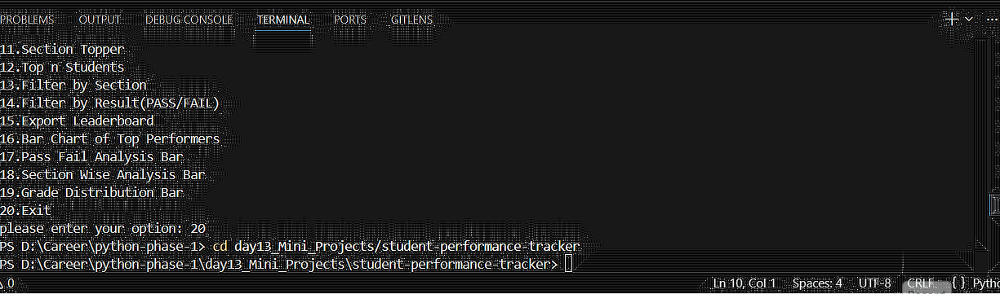
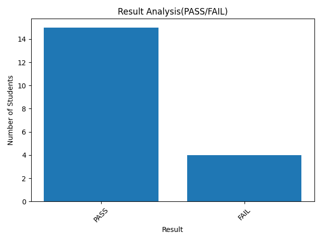
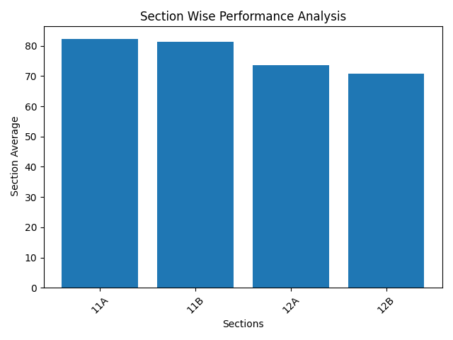

# Student Performance Tracker

I made this while learning Python. It began as a way to save student marks and show rankings, and I kept adding things as I figured out how to calculate them.

The program runs in the terminal. It can manage student records, compare results across sections, save charts and export a leaderboard.

## Demo



## What it does

- Add, view, edit and delete students.
- Rank students by total marks and show the top N.
- Find subject toppers, section toppers and class averages.
- Filter students by section or pass/fail result.
- Create charts using Matplotlib and export a leaderboard as CSV.

Subjects, sections, pass marks and grade ranges are set in [`config.json`](config.json).

## Example charts

| Top performers | Pass/fail |
| --- | --- |
|  |  |

| Section averages | Grade distribution |
| --- | --- |
|  |  |

## Run it

You need Python 3 and Matplotlib.

```bash
git clone https://github.com/Rafidabd/student-performance-tracker.git
cd student-performance-tracker
python -m pip install -r requirements.txt
python main.py
```

The program uses a numbered menu. Student records are saved to `data/students.json`, which is created when needed and ignored by Git. Charts and CSV files go into `Reports/`.

Please use fake or appropriately authorized student data when trying it.

## Project files

```text
student-performance-tracker/
├── Demo/                     # Recorded demo
├── Reports/                  # Example charts and CSV
├── modules/
│   ├── analytics.py          # Rankings and calculations
│   ├── cli.py                # Menu and inputs
│   ├── config_loader.py
│   ├── display.py
│   ├── export.py             # CSV export
│   ├── storage.py            # JSON files
│   ├── student.py            # Add/edit/delete records
│   ├── utils.py
│   └── visualize.py          # Charts
├── tests/test_storage.py
├── config.json
├── main.py
├── requirements.txt
└── README.MD
```

## Tests

```bash
python -m unittest discover -s tests -v
```

The two tests cover creating an empty data file and saving/loading a sample student. They don't test every ranking, chart or menu option yet.

## What I learned from it

I hadn't worked with a program this size before. Separating the calculations, terminal menu, storage and charts into different files made it easier to work on one part without getting lost in the rest of the code.

It still uses local JSON rather than a database and isn't meant to be a school management system. Some of the ideas I explored here later became part of my bigger [Academic Analytics project](https://github.com/Rafidabd/python-phase-1/tree/main/academics_analytics_system).

This project was first built inside [my Python practice repository](https://github.com/Rafidabd/python-phase-1/tree/main/day13_Mini_Projects/student-performance-tracker); the relevant commit history is preserved here.
